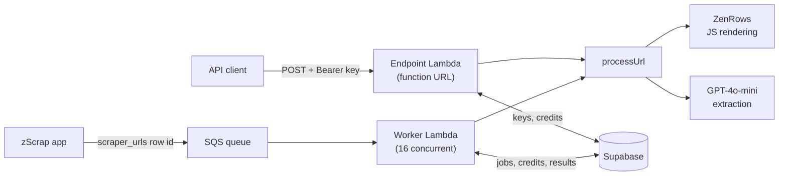

# zScrap scraper

The serverless backend of zScrap's AI web-scraping API, built in September and October 2024. You give it a URL and a plain-English request, optionally with a JSON schema. It renders the page, cleans the HTML, and has GPT-4o-mini return the data as structured JSON.

## How the two repos worked together

| Repo | Role | Ran on |
| --- | --- | --- |
| [`zscrap`](https://github.com/l4j3b/zscrap) | The website and app: sign-up, organizations, scrapers and results, API keys, credits and billing | Cloudflare Pages |
| `zscrap-scraper` (this repo) | The scraping backend: an SQS queue and worker Lambda for jobs from the app, and a public endpoint for API calls | AWS Lambda and SQS |

The app saves the URLs a user adds as `scraper_urls` rows and sends their ids to this repo's queue. The worker scrapes each one and writes the result back to the row, where the app shows it. API customers call the endpoint here directly with the key the app issued to their organization.

```bash
curl -X POST 'https://<function-id>.lambda-url.us-east-1.on.aws' \
  -H 'Content-Type: application/json' \
  -H 'Authorization: Bearer sk_your_api_key' \
  -d '{
    "url": "https://www.youtube.com/watch?v=w4LRUBFy3pc",
    "prompt": "Extract the tracklist."
  }'
```

The response holds the extracted JSON, the schema the model used (yours, or one it inferred), an optional suggestion for a better prompt, the page title, and the token usage and cost of the call.

## How it works



There are two ways in, and both run the same `processUrl` pipeline:

- **Direct API calls** go to the endpoint Lambda through a Lambda function URL. A function URL is used instead of API Gateway because scrapes can run longer than API Gateway's timeout.
- **Batch jobs** from the [zScrap app](https://github.com/l4j3b/zscrap) go through an SQS queue. The worker Lambda loads the job from the `scraper_urls` table, runs it, and writes the status, result, HTML, text and usage back to that row.

The pipeline:

1. **Render.** ZenRows loads the page with JavaScript rendering and US premium proxies, and scrolls it to trigger lazy-loaded content.
2. **Clean.** cheerio removes scripts, styles, SVGs, iframes, attributes, empty tags and comments, which cuts the tokens sent to the model.
3. **Extract.** GPT-4o-mini gets the cleaned HTML and the user's request. It returns the JSON, the schema it followed or inferred, and an optional prompt suggestion, each between delimiters that the code parses out.
4. **Meter.** Each call records prompt and completion tokens and their cost.

## Details worth a look

- **API keys** are sent as `Authorization: Bearer <key>` and stored only as HMAC-SHA256 hashes with a server-side secret ([`scraper-endpoint.ts`](lambda/scraper-endpoint.ts)).
- **Credits** are taken per organization through a `deduct_api_credit` Postgres function before any scraping starts, and refunded with `add_api_credit` if processing fails ([`deduct-api-credit.ts`](lambda/lib/deduct-api-credit.ts), [`scraper-worker.ts`](lambda/scraper-worker.ts)).
- **Concurrency** is capped at 16 reserved worker executions, with one message per batch since a scrape takes around 15 seconds ([`zscrap-cdk-stack.ts`](lib/zscrap-cdk-stack.ts)).
- **Errors** go to Sentry, and each run logs how long scraping and extraction took.
- **`TEST_MODE`** skips ZenRows and OpenAI and returns a placeholder result, so the auth and credit paths can be tested without paying for a scrape.

## Project layout

| Path | What it is |
| --- | --- |
| [`lib/zscrap-cdk-stack.ts`](lib/zscrap-cdk-stack.ts) | CDK stack: SQS queue, worker Lambda, endpoint Lambda and its function URL |
| [`lambda/scraper-endpoint.ts`](lambda/scraper-endpoint.ts) | Direct API: auth, validation, credits, response |
| [`lambda/scraper-worker.ts`](lambda/scraper-worker.ts) | Queue worker: loads the job from Supabase and saves the result |
| [`lambda/lib/process-url.ts`](lambda/lib/process-url.ts) | Render with ZenRows and clean the HTML |
| [`lambda/lib/scrap-gpt.ts`](lambda/lib/scrap-gpt.ts), [`ask-gpt.ts`](lambda/lib/ask-gpt.ts) | Extraction prompt, response parsing, usage and cost |
| [`database.types.d.ts`](database.types.d.ts) | Generated Supabase types for the tables and functions used |

## Running it

Requirements: Node.js 20, Docker (the Lambdas are bundled in Docker for `linux/amd64`), and AWS credentials for `cdk deploy`.

Create a `.env` with:

```bash
API_KEY_SECRET=          # secret used to hash API keys
TEST_MODE=false
SUPABASE_URL=
SUPABASE_ANON_KEY=
ZENROWS_API_KEY=
OPENAI_API_KEY=
SENTRY_DSN=
SENTRY_TRACES_SAMPLE_RATE=
NODE_OPTIONS=
```

Then:

```bash
npm install
npm run deploy   # builds, then runs cdk deploy and prints the function URL
npm test         # end-to-end test of the endpoint; needs SCRAPER_ORG_API_KEY in .env
```

## Notes

Handler exports with Sentry: <https://github.com/aws-observability/aws-otel-lambda/issues/284>
